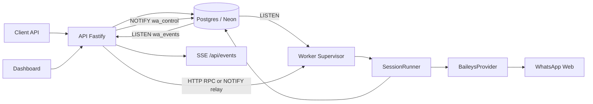
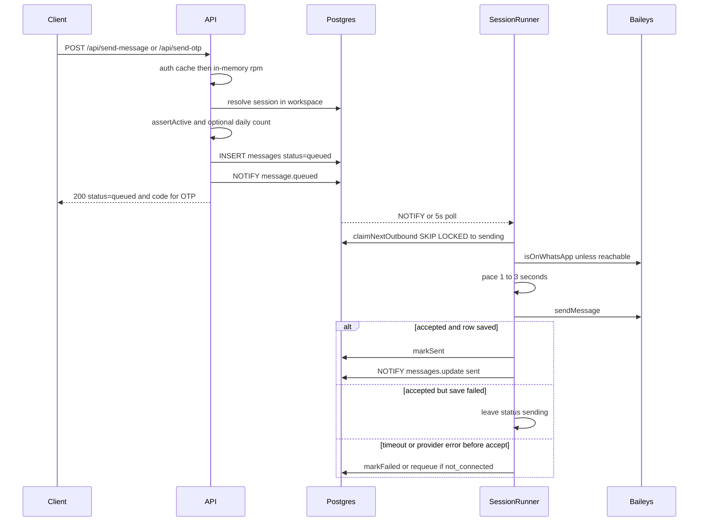

# 02 — Architecture Map

المخطط مبني على الملفات، مش على رسم README وحده. Prisma غير مستخدم. Redis غير موجود. الطابور والحافلة هما Postgres.

## المكونات

| جزء | مسار | دور مؤكد |
|---|---|---|
| API | `apps/api` Fastify 5 | مفاتيح Bearer، خطط، إرسال، SSE، دفع، إدارة |
| Worker | `apps/worker` | `Supervisor` يمتلك sockets. `SessionRunner` لكل جلسة. RPC على `WORKER_PORT` |
| Dashboard | `apps/dashboard` | React. مش جزء من مسار OTP للعميل المتكامل عبر API |
| Provider | `packages/provider` | واجهة `Provider`. التنفيذ الوحيد: `BaileysProvider` |
| DB | `packages/db` Drizzle + postgres.js | schema، migrations، `claimNextOutbound` |
| Shared | `packages/shared` | خطط، عقود الإرسال، إيقاع الحملات |

صورة التشغيل: `Dockerfile` واحد. أمر API هو الافتراضي، والـ worker نفس الصورة بأمر `pnpm --filter @wa/worker start`. `docker-compose.yml` يصف Postgres محلي + API + worker، والتعليق فيه يقول إنه غير مُجرَّب على جهاز التطوير.

`createDb()` يفتح عميلين postgres.js (`packages/db/src/client.ts` 52–56): `sql` للاستعلامات الخام و`db` لـ Drizzle، كل واحد `max` افتراضي 10. الـ API يستخدم الاثنين (`apps/api/src/index.ts` 44). الـ worker يأخذ `sql` فقط بـ `DB_POOL_MAX` افتراضي 20 (`apps/worker/src/config.ts` 23، `apps/worker/src/index.ts` 21)، لكن الدالة ما زالت تنشئ عميل Drizzle كسول غير مستخدم.

LISTEN يحتاج `DATABASE_URL_UNPOOLED` (`createListener`). القنوات: `wa_control` من API إلى workers، `wa_events` نحو SSE، `wa_rpc` لرد الـ relay، `wa_auth` لإبطال الكاش.

## رسم الاعتماد

لا توجد بوابة API منفصلة. Fastify هو الحد. لا يوجد خدمة OTP مستقلة.

## دورة الجلسة

1. صف في `sessions` مع `desired_state`.
2. كل `Supervisor` يعمل heartbeat في `workers` (الافتراضي كل 5 ثوانٍ).
3. يلتقط جلسات `desired_state = 'running'` حتى `WORKER_CAPACITY` (افتراضي 100) بـ `FOR UPDATE SKIP LOCKED` مرتبة بـ `updated_at` (`apps/worker/src/supervisor.ts` 238–253).
4. جلسة يتأخر heartbeat مالكها 60 ثانية يمكن أخذها. لو الـ worker نفسه لا يصل heartbeat لمدة 30 ثانية يغلق sockets أولًا (`fence`) حتى لا يُفتح الرقم مرتين.
5. `WORKER_CLAIM` ينطفئ على جهاز تطوير حتى لا ينافس إنتاج Railway على نفس القاعدة. هذا مؤكد في `apps/worker/src/config.ts` 29–50. عدد workers في الإنتاج **UNVERIFIED**.

رسالة WhatsApp لا تُفتح على عاملين. هذا القيد صحيح ومقصود.

## تسلسل إرسال رسالة عميل

الإيصال `delivered` / `read` يأتي لاحقًا عبر أحداث Baileys ويتحرك للأمام فقط (`advanceStatus` في `packages/db/src/queue.ts` 164–180). غياب الإيصال لا يعيد الإرسال.

## مسارا OTP — لا يُخلطا

### أ. OTP تكامل العميل

`apps/api/src/routes/messages.ts` الدالة `enqueue` ثم `POST /send-otp` (سطر 170–209).

- يولّد الكود بـ `randomInt` أو يقبل كود العميل (4–10 أرقام).
- يضع النص في `messages.content`.
- `idempotencyKey` يُمرَّر `null` (سطر 194). مسار `/send-message` يقبل الهيدر؛ مسار OTP لا يعرّفه في الـ schema.
- الرد `queuedResponse` زائد `code`.
- لا جدول تحقق، لا HMAC، لا استهلاك لمرة واحدة، لا TTL.
- العامل يعاملها كأي نص صادر.

### ب. تحقق هاتف المنصة نفسها

`apps/api/src/lib/verification.ts` و`apps/api/src/lib/otp.ts`.

- HMAC للكود مربوط بـ id التحقق (`hashOtp`).
- TTL 10 دقائق، 5 محاولات، تبريد إعادة إرسال 60 ثانية، 5 إرسالات، عمر تدفق ساعة (`OTP_POLICY`).
- حظر في `throttles`: 5/ساعة و10/يوم لكل رقم، 10/ساعة لكل IP، وسقف يومي `OTP_DAILY_LIMIT` افتراضي 1000.
- الإرسال `OtpSender`: Twilio إذا `OTP_CHANNEL=sms` والمفاتيح مكتملة، أو `whatsappSender` الذي يستدعي RPC `send-text`.
- `sendDirect` (`apps/worker/src/runner.ts` 1016–1022) يرسل فورًا **خارج الطابور وبدون تخزين النص**.
- لو القناة غير مهيأة، المرسل `null` والتسجيل يُرفض. لا fallback صامت (`apps/api/src/index.ts` 50–60).
- قيمة القناة في الإنتاج **UNVERIFIED**.

`sendDirect` لا يأخذ قفل `draining`. طلبات متزامنة تقدر تستدعي `provider.send` بالتوازي مع طابور الجلسة نفسه.

## الطابور

ليس BullMQ. الدالة `claimNextOutbound` (`packages/db/src/queue.ts` 24–40):

- أقدم `id` بحالة `queued` و`not_before` فارغ أو حلّ موعده.
- تحديث ذرّي إلى `sending` مع `SKIP LOCKED`.
- حلقة واحدة لكل جلسة (`requestDrain` يدمج الاستدعاءات المتزامنة).
- حملات لها `not_before` في المستقبل لا تسبق رسالة `not_before` فارغة.
- حملة **مستحقة** (موعدها فات) تدخل نفس الترتيب مع OTP. لا عمود أولوية.

إيقاع النص العادي في `pace` (`runner.ts` 840–856): `SEND_DELAY_MIN_MS` افتراضي 1000 و`SEND_DELAY_MAX_MS` افتراضي 3000. رسالة نص ليست من صفحة المحادثات تنتظر على الأقل الحد الأدنى، وتظهر "يكتب…". رسالة واحدة لا تنتظر أكثر من ذلك لو الجلسة كانت فاضية منذ زمن (`lastSentAt = 0`).

حملات الإعلانات لها إيقاع أبطأ في `packages/shared/src/broadcasts.ts`: فجوات 8–60 ثانية، راحة بعد دفعة، وسقف يومي 150/300/400 حسب الوتيرة، مع إحماء للرقم الجديد. هذا السقف **لا يُطبَّق** على `POST /api/send-otp`.

## خطط وحدود

`packages/shared/src/plans.ts` 21–29:

| خطة | جلسات | rpm | رسائل يومية | احتفاظ مُعلَن |
|---|---|---|---|---|
| trial | 1 | 10 | 50 | 7 |
| basic | 1 | 60 | بلا حد (`null`) | 30 |
| pro | 3 | 120 | بلا حد | 60 |
| plus | 6 | 120 | بلا حد | 60 |
| business | 10 | 120 | بلا حد | 90 |
| enterprise | 25 | 300 | بلا حد | 90 |
| unlimited | 10000 | 2000 | بلا حد | 365 |

`assertDailyQuota` (`apps/api/src/lib/limits.ts` 50–60) يعمل فقط عندما `dailyMessages` ليس `null`، أي التجربة عمليًا. العد `COUNT(*)` ثم الإدراج خارج نفس القفل. التعليق في الكود يقول إن التجاوز المتزامن محدود. **CONFIRMED** إنه ليس ذرّيًا.

`assertActive` يمنع الإرسال والربط بعد انتهاء التجربة أو الخطة (402). إيقاف المستخدم (`apps/api/src/routes/admin.ts` 273–315) يلغي جلسات اللوحة، يوقف الجلسات، ويفشل الرسائل `queued` بسبب `Account suspended`. صفوف `sending` لا تُفشل في نفس العبارة.

الـ rpm في `apps/api/src/app.ts` 287–301. المخزن افتراضي لمكتبة `@fastify/rate-limit` (ذاكرة العملية). لا Redis store في الاستدعاء. مفتاح الجلسة `s:{sessionId}`، ومفتاح الـ workspace `w:{workspaceId}`، واللوحة `c:{workspaceId}` بحد أدنى `CONSOLE_RPM = 240`. نسخ API متعددة **تضرب** الحد. عدد النسخ **UNVERIFIED**.

مهلة المعالج 60 ثانية (`HANDLER_TIMEOUT_MS`) ترسل 503 ولا تلغي عمل SQL الجاري.

## ما هو غير منفّذ

| بند | الحالة |
|---|---|
| Prisma | NOT IMPLEMENTED |
| Redis / BullMQ | NOT IMPLEMENTED |
| WhatsApp Cloud API كمزود إرسال | NOT IMPLEMENTED |
| حذف سجل الرسائل حسب `retentionDays` | NOT IMPLEMENTED (الحقل يُعرض في الواجهة فقط) |
| OpenTelemetry / Prometheus / Sentry | NOT IMPLEMENTED (لا مراجع في الكود) |
| نطاقات مفتاح `send` / `otp` | NOT IMPLEMENTED (`scopes` يُفحص لـ `console` فقط) |
| أولوية OTP أو إلغاء بعد الصلاحية في طابور العميل | NOT IMPLEMENTED |

## عنق الزجاجة ونقطة الفشل

- **جلسة واحدة = مرسل واحد مسلسل.** هذا أقوى قيد لسيناريو الألف OTP.
- **Neon واحد** للحالة والطابور والحافلة. انقطاعه يوقف الجميع. بعد 30 ثانية بلا heartbeat تُغلق المقابس.
- **NOTIFY غير مضمون** عند فجوة LISTEN. التعويض موجود: المصالحة كل 5 ثوانٍ تعيد نكز الجلسات التي لها صفوف مستحقة (`supervisor.ts` 256–263). التأخير الإضافي حتى 5 ثوانٍ، والصف لا يضيع.
- **تجمع الاتصالات** صغير مقابل دفقة طلبات تقبلها خطة `unlimited` (2000/دقيقة) إذا وصلت مع استعلامات أخرى (محادثات، مزامنة، مفاتيح Signal).
- **لا حد لعمق `queued`.** القبول يستمر طالما الـ rpm يسمح والجلسة `connected` أو `connecting`.
- **ذاكرة العامل** مع مئات الجلسات: كل جلسة socket وcache مفاتيح. السعة الافتراضية 100 جلسة لكل worker. لم يُقس استهلاك الذاكرة. الحكم: **UNVERIFIED** كرقم، والتصميم بلا حد ذاكرة لكل جلسة خطر **PROBABLE** عند اقتراب السعة مع مزامنة تاريخ.

عزل المستأجرين على مستوى الصف جيد. عزل الموارد (اتصالات، مقاعد worker، رقم WhatsApp المشترك للمنصة) غير موجود كحصص عادلة.
