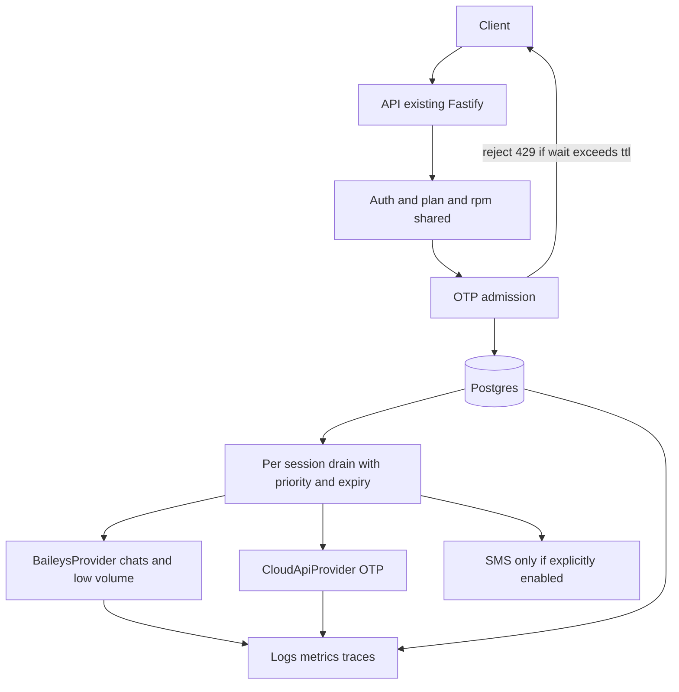
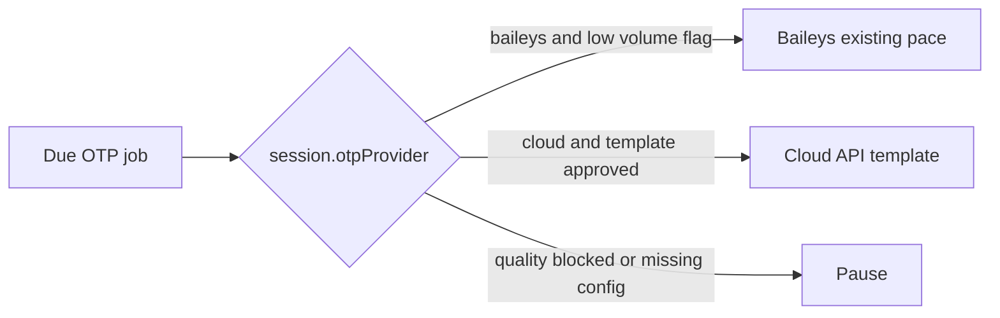

# 08 — Target Architecture

التحسين تدريجي. إعادة كتابة المنصة غير مطلوبة: الطابور في Postgres، وسياج الجلسة، وعزل `workspace_id`، وتحقق هاتف المنصة أجزاء تُبنى عليها. ما يُستبدل هو وعد OTP عالي الحجم فوق Baileys، وغياب سقف الطابور، وتخزين الكود كنص.

لا يُضاف Redis في الخطوة الأولى. الطابور الحالي معمر و`SKIP LOCKED` يعمل. BullMQ يفيد عند تعدد عمال الإرسال لنفس الرقم على مزود HTTP (Cloud API) مع معدل مشترك وأولوية. إدخاله قبل مزود رسمي يضيف تشغيلًا بلا رفع السعة الحقيقية، لأن عنق الزجاجة هو المقبس المسلسل لا Postgres.

## الشكل المستهدف

`sms` لا يُستدعى إلا بوجود إعداد `enabled` ومفاتيح وموافقة مسار. الفشل على واتساب لا يقفز إليه وحده.

## قرارات ملموسة

### القبول

قبل INSERT لـ OTP:

- قدّر الانتظار: `(عدد queued + sending للجلسة) / μ`. μ الابتدائي = 1/2 رسالة لكل ثانية ما دام `SEND_DELAY` الافتراضي، ويُستبدل بمتوسط متحرك لآخر 50 إرسالًا ناجحًا **مُقاسًا** (زمن pace + lookup + send).
- إذا التقدير أكبر من `ttl` المطلوب (من الجسم، بسقف 10 دقائق وبحد أدنى 60 ثانية) ارفض 429 `otp_would_expire` بلا صف.
- سقف عمق لكل جلسة، بداية 100 صف OTP. الزائد 429 `queue_full`.
- سقف لكل مستلم: مثلًا 5 إرسالات / ساعة / (workspace, phone) في `throttles` الموجود. هذا يعيد استخدام `createThrottle`.
- حد الخطة اليومي ذرّي: `INSERT ... SELECT WHERE (SELECT count...) < limit` أو عداد في صف المساحة يُقفل بـ `FOR UPDATE`. يُطبَّق على المدفوع أيضًا بقيمة تعاقدية، لا `null`.
- rpm يبقى، ويُنقل إلى Postgres أو Redis **عندما** توجد أكثر من نسخة API. إلى ذلك سجّل عدد النسخ في التشغيل حتى لا يُفهم الحد كأنه عالمي. حالة النسخ اليوم UNVERIFIED.

الرد:

- `202` أو الإبقاء على `200` مع `status: queued` و`accepted: true` و`delivered: false`.
- لا حقل يعني أن الهاتف استلم.
- الكود يُرجع مرة واحدة لمن ولّده الخادم إذا بقي العقد هكذا، ولا يُخزَّن في `content`. الأفضل: العميل يولّد الكود ويحتفظ به، والمنصة ترسل النص ولا تعيد الكود في `GET /messages`. التخزين المحلي للكود عند العميل خارج النطاق؛ المنصة تتوقف عن أرشفته.

### الطابور

يبقي في `messages` للرسائل العادية حتى لا تُكسر الحملات والمحادثات.

لـ OTP أضف أعمدة أو جدولًا ضيقًا:

- `priority` (OTP أعلى من حملة مستحقة).
- `expires_at`.
- `kind = 'otp'`.
- claim: `ORDER BY priority DESC, id` مع تخطي `expires_at < now()` وتعليمها `failed` / `expired` **بدون** `provider.send`.
- لا إعادة تلقائية لرفض دائم (رقم غير موجود، 463، قالب مرفوض، مستخدم حاجب).
- timeout بعد شروع الإرسال: حالة `uncertain` لا `failed`، وبلا إعادة آلية.
- idempotency إلزامي أو مُولَّد من `(workspace, to, code-hash, نافذة دقيقة)` حتى إعادة الشبكة لا تصنع كودًا ثانيًا. مفتاح العميل على `/send-otp` بنفس آلية `/send-message`.

حملة مستحقة لا يجوز أن تتقدم على OTP لم تنته صلاحيته. هذا تغيير ترتيب في `claimNextOutbound` مش نظام طوابير جديد.

العدل بين المستأجرين: الإرسال أصلًا حلقة لكل جلسة. أضف سقف جلسات مملوكة لكل workspace على العامل، بداية يساوي حد الخطة، والتقاط round-robin بين المساحات بدل `updated_at` فقط عندما المقاعد أضيق من الطلب. لا تُبنَ جدولة معقدة قبل قياس حرمان فعلي.

### المزود

Baileys يبقى افتراضيًا للمحادثة حتى لا ينكسر المنتج. OTP الحجم العالي يتطلب `otpProvider=cloud` صريحًا. غيابه = رفض المسار عالي الحجم لا تبديل خفي.

Cloud API:

- قالب authentication معتمد، معاملات الكود ومدة الصلاحية فقط.
- خزن `throughput` وحد المراسلة الأخيرين من webhook / استعلام الرقم. لا تثبّت 80 في الكود كأنها ضمان؛ اجعلها سقفًا ابتدائيًا يُخفَّض عند `130429`.
- عدّ المستلمين الفريدين خارج نافذة الخدمة خلال 24 ساعة. عند الاقتراب من حد المحفظة ارفض مبكرًا `messaging_limit`.
- webhook الحالة يحدّث `sent` / `delivered` / `failed` مع إزالة تكرار `wamid`.
- مهلة الرد أقل من 250 مللي في الوسيط عند ارتفاع الحجم، لأن Meta تعيد المحاولة 7 أيام. هذا شرط تشغيل عند تفعيل القناة لا اليوم.

Circuit: ثلاث رموز تقييد أو جودة حمراء خلال 10 دقائق توقف قبول OTP للرقم وتُبقي الصفوف تنتهي `expired` بدل الإرسال.

### تحقق المنصة

أصلح `resend` ليرسل ثم يبدل الهاش، أو يبدل الهاش ويعيد القديم إذا فشل الإرسال، داخل حالة واضحة. أبقِ HMAC والحدود. لا توجّه أكواد دخول الموظفين/العملاء على الجلسة المشتركة عبر Baileys إذا أمكن SMS مهيأ. هذا قرار تشغيل: الكود يدعم القناتين.

### المراقبة المناسبة لـ Railway

لا تشترِ منصة كبيرة قبل وجود مقاييس. الترتيب:

1. لوجات Pino الحالية + عدم طباعة `content` أبدًا + `requestId` موجود. أضف حقولًا رقمية: `sessionId` مقصوص، `waitMs`، `providerMs`، `status`. بلا هاتف وبلا كود.
2. endpoint `/metrics` بصيغة Prometheus على الشبكة الداخلية فقط: عمق الطابور، أقدم `queued`، عد `expired`، جلسات متصلة، نبض العامل، أخطاء الإرسال، زمن SQL. Railway يسمح بجمع هذا بـ Grafana Cloud مجاني الطبقة الصغيرة أو بـ scrape لاحق.
3. OpenTelemetry traces لاحقًا على مسار الإرسال فقط (قبول، claim، provider). التصدير إلى نفس Grafana أو إلى Honeycomb إذا وُجد حساب. ليس شرطًا للإطلاق الأول.
4. Sentry للأخطاء غير المتوقعة في API والعامل، مع `beforeSend` يحذف الجسم والهواتف. مفيد ورخيص نسبيًا. ليس بديلًا لمقياس الطابور.

لوحة تشغيل واحدة تعرض: قبول/رفض، عمق وأقدم عمر، expired، connected مقابل disconnected، 463 و130429، حصة المستأجر، فشل webhook. العميل يرى حالة رسالته `queued | sent | uncertain | expired | failed` بلا ادعاء `delivered` إلا بإيصال.

### الفوترة والعزل بلا لمس Kashier

لا تُغيَّر جلسات الدفع. أضف قياسًا:

- العد اليومي ذرّي لكل مساحة، والفشل لا يُحسب مرتين إذا كان retry لنفس idempotency.
- رسالة `failed` قبل قبول المزود لا تُخصم من حصة "مُرسلة". رسالة `sent` أو `uncertain` تُخصم لأن التكلفة أو خطر الرقم وقع. وثّق ذلك في صفحة الخطة؛ اليوم الخطة المدفوعة بلا حصة رسائل أصلًا.
- إعادة الإرسال من العميل صف جديد وتُحسب. هذا صحيح.
- انتهاء الخطة يبقى 402. أضف إيقاف الإرسال عند الإيقاف الإداري وهو موجود للـ `queued`.
- تكلفة Cloud API تُسجَّل كعد قوالب authentication لكل workspace حتى تُسعَّر لاحقًا. لا تُدمج في مبلغ Kashier في هذه المرحلة.
- مستأجر عالي الحجم لا يفتح جلسات بلا حد: `unlimited` داخلي فقط. عميل OTP يحتاج سقف جلسات وسقف قبول مربوطين بعقد، لا بخطة `dailyMessages: null`.

### إساءة الاستخدام

تلقائي بلا بشر:

- تجاوز حد المستلم أو rpm أو عمق الطابور: 429.
- نسبة فشل مرتفعة أو 463: إيقاف إرسال OTP للجلسة.
- نمط أرقام متتالية فوق عتبة (مثل 50 رقمًا متتاليًا في ساعة): إيقاف الجلسة ووضعها في طابور مراجعة. العتبة تُضبط بعد أسبوع قياس حتى لا تُعاقب حملة شرعية؛ القيمة الابتدائية المقترحة محافظة وتُراجع.

بشري:

- إيقاف الحساب الموجود أصلًا مع السبب في audit.
- شكوى spam، طلب جهة، أو جودة Cloud حمراء.
- إعادة التفعيل لا تعيد الصفوف `expired` ولا `failed`؛ العميل يرسل من جديد إذا ما زال الكود صالحًا عنده.

إجراء الاستجابة: أوقف الجلسة، افشل `queued`، احتفظ بصفوف `uncertain`، سجّل `user.suspend` أو حدث `session.pause` جديد، أبلغ المالك، لا تنقل الترافيك لرقم آخر.

## ما لا يُبنى الآن

- عشرة آلاف عامل Baileys.
- تدوير أرقام أو بروكسي أو بصمات.
- طابور Redis موازٍ لطابور Postgres للرسائل العادية.
- ضمان exactly-once نحو واتساب.
- إعادة تصميم اللوحة أو الدفع.

## SLO ابتدائي صادق

إلى أن يوجد Cloud API مُفعَّل ومُقاس:

- قبول API لطلب OTP (قرار 200 أو 429) p99 أقل من ثانية على قاعدة سليمة. غير مُقاس اليوم.
- لا قبول إذا الانتظار المقدَّر أكبر من TTL.
- على Baileys افتراضي: لا تَعِد بأقل من دقيقة لرسالة، ولا بأكثر من نحو 50–100 OTP متزامنة لكل جلسة لكل 5 دقائق.
- بعد Cloud API على رقم بلا حد مراسلة وthroughput مؤكد 80: ألف قالب نظريًا في أقل من نصف دقيقة **إذا** حد المستلمين يسمح بالألف الفريدين. محفظة جديدة عند 250 لا تحقق هذا اليوم الأول. اكتب الحد في العقد من قيمة الحساب الفعلية لا من وثيقة "حتى 80".
