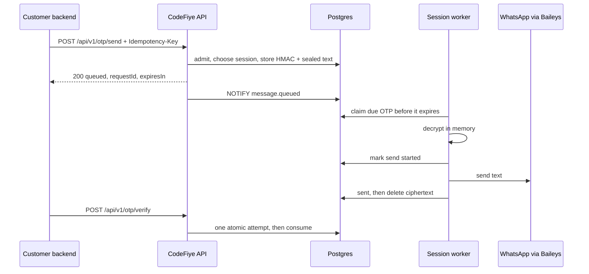
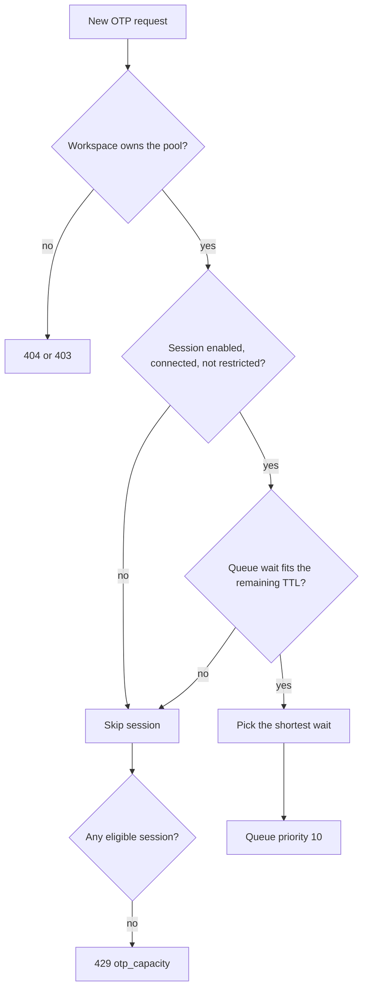

# OTP Sender Pool

ملخص: كل مساحة عمل تجمع جلسات واتساب التي تملكها في مجمّع إرسال، وتستدعي API واحداً من خادمها. المنصّة تختار جلسة مؤهلة، وتخزّن الرمز كـ HMAC، وتشفّر نص الرسالة حتى لحظة الإرسال. `queued` يعني أن الطلب دخل الطابور، لا أن الرسالة وصلت.

This document describes the local implementation. It is not a production rollout, and it does not claim that Baileys can deliver unlimited traffic or avoid WhatsApp restrictions.

## Request flow





## What a pool is

A pool belongs to one workspace. Members are sessions of that same workspace. Another workspace's session cannot be added: the insert checks `sessions.workspace_id`.

One pool can be the default. A key may be pinned to one pool (`otp_pool_id`). A pinned key cannot send through a different pool.

Removing a member that still has queued or processing jobs marks it `draining` and disables it. Those jobs stay on that session. New jobs do not. Deleting a pool that still has queued, processing, or uncertain jobs returns `409 pool_busy`.

A restricted session receives no new OTP jobs. Traffic that WhatsApp restricted is not moved to another number.

## Public API

All routes are under `/api`. The response envelope is `{ "success": true, "data": { ... } }`.

Authenticate with a workspace token (`wap_…`), never a browser session cookie and never a `was_…` session key. OTP keys created from the dashboard have scopes `otp:send` and `otp:verify` only. They cannot call the rest of the API.

| Method | Path | Scope |
| --- | --- | --- |
| POST | `/api/v1/otp/send` | `otp:send` |
| POST | `/api/v1/otp/verify` | `otp:verify` |
| POST | `/api/v1/otp/resend` | `otp:send` |
| GET | `/api/v1/otp/:requestId` | `otp:send` |

`POST /api/send-otp` is unchanged.

### Send

`Idempotency-Key` is required (8–200 characters). The same key and the same recipient return the original request. The same key with a different recipient returns `409 idempotency_conflict`. The code is not in the response.

```http
POST /api/v1/otp/send
Authorization: Bearer wap_…
Idempotency-Key: login-user-42-2026-11-19T10:00:00Z
Content-Type: application/json

{"senderPoolId":"…","to":"+201012345678","purpose":"login","ttlSeconds":300,"lang":"ar"}
```

`senderPoolId` is optional when the key has a pool or the workspace has a default pool.

```json
{ "success": true, "data": { "requestId": "…", "status": "queued", "expiresIn": 300 } }
```

`status: "queued"` means the job was accepted into Postgres. It does not mean WhatsApp accepted it, and it does not mean the phone received it.

### Verify

```json
{ "requestId": "…", "code": "123456" }
```

A correct code is consumed once. A parallel request cannot consume it again. Wrong guesses spend `maxAttempts`. After that the challenge is `locked`. Unknown, used, and foreign-workspace ids return the same `404 challenge_not_found`.

### Status and resend

Status returns delivery state, verification state, expiry, failure category, and whether a resend is currently allowed. It does not return the code or the full phone number.

Resend keeps the same sender when sending already started. It may choose another eligible session only when sending never started and the previous attempt failed or expired. `uncertain` is never resent automatically. A restricted session is not replaced. Cooldown and `maxSends` apply.

### Errors

| HTTP | Code | Meaning |
| --- | --- | --- |
| 401 | | Missing or bad token |
| 403 | `scope_required`, `pool_forbidden` | Key cannot do this, or it is pinned to another pool |
| 404 | `pool_not_found`, `challenge_not_found` | Missing pool, or a challenge that must not be distinguished |
| 409 | `pool_paused`, `pool_busy`, `idempotency_conflict`, `uncertain_delivery` | State conflict |
| 422 | `code_invalid`, `code_expired` | Verify failed validation |
| 429 | `otp_capacity`, `otp_daily_limit`, `rate_limited` | No safe sender, daily cap, or recipient cap. `Retry-After` is set |
| 503 | `otp_unavailable` | `AUTH_ENCRYPTION_KEY` is missing, so nothing is queued in plaintext |

## Server integration

Call CodeFiye from the customer's backend. Do not put the API key in a Flutter app, a browser, or a mobile binary.

### Node.js / Express

```js
import express from 'express';
const app = express();
app.use(express.json());

app.post('/auth/otp', async (req, res) => {
  const response = await fetch('https://wa.codefiye.com/api/v1/otp/send', {
    method: 'POST',
    headers: {
      authorization: `Bearer ${process.env.CODEFIYE_OTP_KEY}`,
      'content-type': 'application/json',
      'idempotency-key': `login:${req.body.userId}:${req.body.attemptId}`,
    },
    body: JSON.stringify({ to: req.body.phone, purpose: 'login', ttlSeconds: 300 }),
  });
  const body = await response.json();
  if (!response.ok) return res.status(response.status).json(body);
  // Store requestId against the user. Do not treat queued as delivered.
  res.json({ requestId: body.data.requestId, expiresIn: body.data.expiresIn });
});

app.post('/auth/otp/check', async (req, res) => {
  const response = await fetch('https://wa.codefiye.com/api/v1/otp/verify', {
    method: 'POST',
    headers: {
      authorization: `Bearer ${process.env.CODEFIYE_OTP_KEY}`,
      'content-type': 'application/json',
    },
    body: JSON.stringify({ requestId: req.body.requestId, code: req.body.code }),
  });
  res.status(response.status).json(await response.json());
});
```

### Next.js (route handler)

```ts
export async function POST(request: Request) {
  const { phone, userId, attemptId } = await request.json();
  const response = await fetch('https://wa.codefiye.com/api/v1/otp/send', {
    method: 'POST',
    headers: {
      authorization: `Bearer ${process.env.CODEFIYE_OTP_KEY}`,
      'content-type': 'application/json',
      'idempotency-key': `login:${userId}:${attemptId}`,
    },
    body: JSON.stringify({ to: phone, purpose: 'login' }),
  });
  return Response.json(await response.json(), { status: response.status });
}
```

### Laravel

```php
$response = Http::withToken(config('services.codefiye.otp_key'))
    ->withHeaders(['Idempotency-Key' => 'login:'.$userId.':'.$attemptId])
    ->post('https://wa.codefiye.com/api/v1/otp/send', [
        'to' => $phone,
        'purpose' => 'login',
        'ttlSeconds' => 300,
    ]);
```

Verify with `POST https://wa.codefiye.com/api/v1/otp/verify` and `{ requestId, code }`. Read `$response->json('data.status')`. Do not sign the user in on `queued`.

### ASP.NET Core

```csharp
var request = new HttpRequestMessage(HttpMethod.Post, "https://wa.codefiye.com/api/v1/otp/send");
request.Headers.Authorization = new AuthenticationHeaderValue("Bearer", otpKey);
request.Headers.TryAddWithoutValidation("Idempotency-Key", $"login:{userId}:{attemptId}");
request.Content = JsonContent.Create(new { to = phone, purpose = "login", ttlSeconds = 300 });
var response = await http.SendAsync(request);
```

Keep `otpKey` in configuration or a secret store.

### Flutter

```text
Flutter app  →  customer backend  →  CodeFiye OTP API
```

The app sends the phone number and later the code the user typed to the customer's own API. The customer's server holds `CODEFIYE_OTP_KEY` and calls send, verify, resend, and status. The key is not in the Flutter project, not in `dart-define`, and not in the binary.

## Routing

`chooseOtpSession` keeps a session only when it is enabled, `membership = active`, connected with `desired_state = running`, not inside the restriction window, under the plan's per-session queue cap, and able to finish inside the remaining TTL at the configured send estimate (`OTP_DEFAULT_SEND_MS`, 2 seconds, until a measured average exists).

Among those, the shortest projected wait wins. A tie goes to the session assigned least recently. This is workload placement, not number rotation to avoid detection.

OTP rows use `messages.priority = 10`. Ordinary messages stay at `0`, so a due OTP is claimed before a due campaign on the same session. The per-session pace is unchanged.

The per-session queue cap is enforced inside the send transaction by locking the session row and counting queued and sending OTP messages. Two requests cannot both pass a full session. If no eligible session can finish inside the remaining TTL, the API returns `429 otp_capacity` and does not insert a message.

## OTP storage

- The code is generated with `crypto.randomInt` on the API.
- `otp_challenges.code_hash` is HMAC-SHA256 (`hashOtp`) bound to the challenge id. Comparison uses `timingSafeEqual`.
- The worker needs the text once. It is stored in `delivery_ciphertext` with AES-256-GCM. The key is HKDF from `AUTH_ENCRYPTION_KEY` (`otpDeliveryKey`: salt `otp-delivery`, info `otp-delivery-v1`). AAD is `otp:{challengeId}`.
- The message row stores the placeholder `••••••`. SSE and message history do not contain the code.
- The worker decrypts into memory, calls `markOtpSendStarted` immediately before `provider.send`, and clears the ciphertext on `sent`, `expired`, and `uncertain`.
- A failure after send has started becomes `uncertain` and is not queued again.
- A worker crash leaves the message `sending`. On the next start, `failInterrupted` fails the message and `markInterruptedOtpUncertain` clears the ciphertext. It is not sent again.
- Expired queued rows are failed by `expireQueuedOtp` before the next claim, and `claimNextOutbound` skips `expires_at <= now()`.
- Rotating `AUTH_ENCRYPTION_KEY` makes existing sealed payloads unreadable. Do not rotate it while OTP jobs are queued. The HMAC key is separate (`OTP_SECRET`, or a key derived from `WORKER_SECRET`).

## Limits

Plan caps live in `otpPlanLimits` and are separate from the existing message plan object:

| Plan | Pools | Sessions / pool | Daily OTP admissions | Queue / session |
| --- | ---: | ---: | ---: | ---: |
| trial | 1 | 1 | 50 | 20 |
| basic | 1 | 1 | 300 | 30 |
| pro | 2 | 3 | 1,000 | 40 |
| plus | 3 | 6 | 3,000 | 40 |
| business | 5 | 10 | 8,000 | 40 |
| enterprise | 10 | 25 | 20,000 | 60 |
| unlimited | 100 | 100 | none | 80 |

Daily admission is one atomic upsert. Recipient caps are 5 per hour and 10 per day per workspace and phone. The existing per-process HTTP rate limit still applies and is not shared across API processes.

Transactional purposes are `login`, `register`, `verify`, `reset`, and `transaction`. Campaign opt-out is not applied to these user-requested codes. Marketing is not a purpose.

## Dashboard

`/otp` in the dashboard: overview, pools, a one-time OTP key, masked logs, and server-side settings. The log shows a masked phone and statuses. It does not show the code.

## Rollback

Migration `0032_otp_sender_pools` is additive: new tables, nullable columns, and `messages.priority` defaulting to `0`. Do not run it on production until it has been applied to an isolated database.

Rolling back the application code leaves the new tables unused. The legacy send path does not read them. Dropping the migration later means dropping the new tables and the three message columns, which deletes OTP challenge history. Do that only on a database you are allowed to change.

## What this does not do

- It does not replace Baileys or add the WhatsApp Cloud API.
- It does not promise delivery, a ban-free account, or throughput equal to the number of sessions.
- It does not move restricted traffic onto another number.
- It does not send WhatsApp messages from tests.
